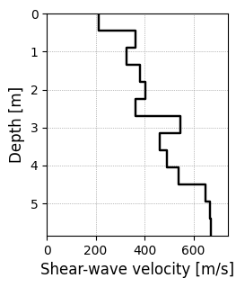
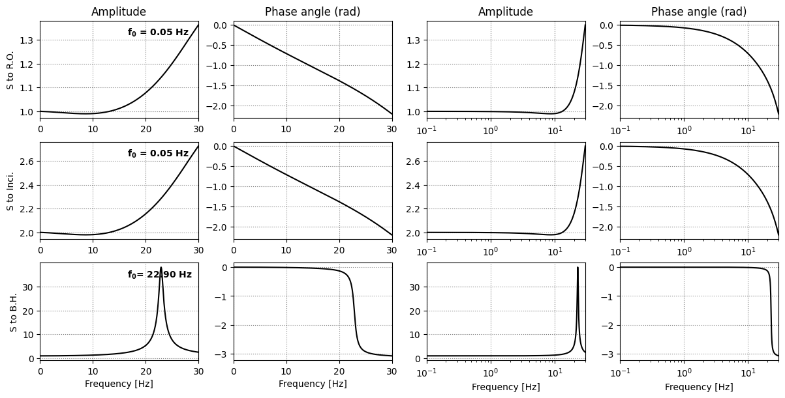

# 1-D Site Response of Kathmandu Valley Boreholes

Kathmandu Valley sits on thick lacustrine and fluvial sediments that strongly amplify earthquake shaking, as the 2015 Gorkha earthquake showed. This project estimates shear-wave velocity (Vs) profiles from Standard Penetration Test (SPT) blow counts and computes linear site amplification functions for 19 boreholes.

## Method

1. **SPT-N → Vs.** Each borehole's SPT-N values are converted to Vs with two empirical correlations:
   - Ohta & Goto (1978)
   - Imai & Tonouchi (1982)
2. **Soil column.** Each profile is a layered column (thickness, Vs, damping, density) over an elastic half-space. Small-strain damping decreases as Vs increases.
3. **Amplification.** [PySeismoSoil](https://github.com/jsh9/PySeismoSoil) computes linear transfer functions relative to the rock outcrop (R.O.), the incident wave (Inci.) and the borehole motion (B.H.), with fundamental frequencies f0.

## Files

| File | Contents |
|------|----------|
| `site_response_kathmandu.ipynb` | Original analysis for every borehole and correlation, with all plots |
| `data/vs_profiles.csv` | All 38 profiles (19 boreholes × 2 correlations) in one table |
| `run_site_response.py` | Runs every profile from the CSV, saves plots and a `summary.csv` with Vs30 and f0 |
| `figures/` | `<site>_<correlation>_vs_profile.png` and `<site>_<correlation>_amplification.png` |

### `vs_profiles.csv` columns

| Column | Unit | Notes |
|--------|------|-------|
| `site` | – | `BH1`, `Airport-BH1`, `BH2` … `BH18` |
| `vs_correlation` | – | `Ohta-Goto` or `Imai` |
| `layer` | – | layer number (top = 1); the last layer is the half-space (thickness 0) |
| `thickness_m` | m | |
| `vs_mps` | m/s | |
| `damping_pct` | % | |
| `density_gcc` | g/cm³ | |

## Usage

```bash
pip install PySeismoSoil pandas matplotlib
python run_site_response.py                    # all boreholes → output/
python run_site_response.py --site Airport-BH1 # a single borehole
```

## Example

<p align="center">
  
  
</p>

## References

- Ohta, Y., & Goto, N. (1978). Empirical shear wave velocity equations in terms of characteristic soil indexes. *Earthquake Engineering & Structural Dynamics*, 6(2), 167–187.
- Imai, T., & Tonouchi, K. (1982). Correlation of N-value with S-wave velocity and shear modulus. *Proc. 2nd European Symposium on Penetration Testing*, Amsterdam, 67–72.
