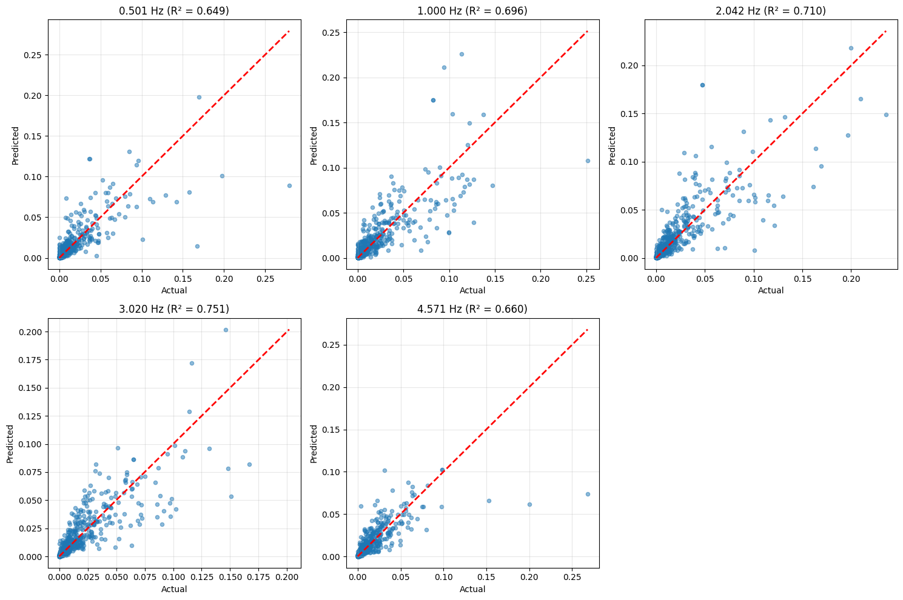
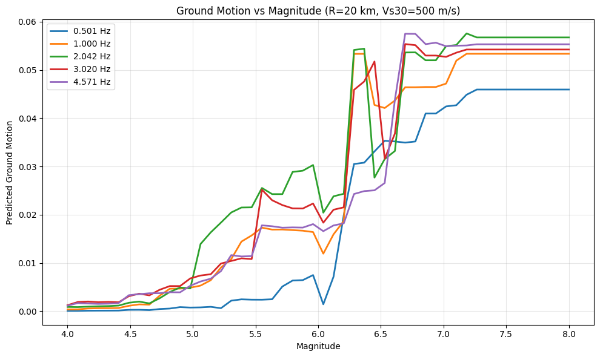
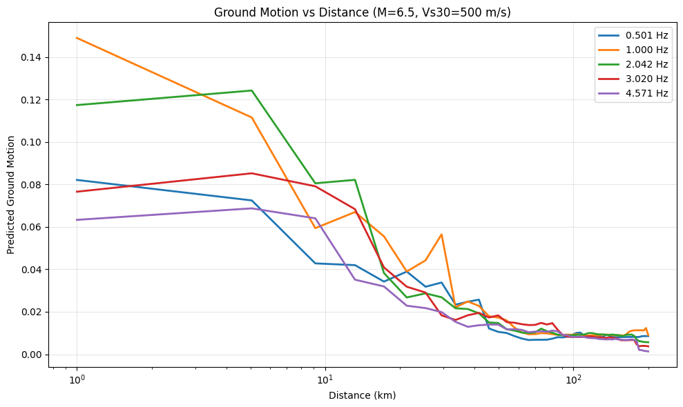
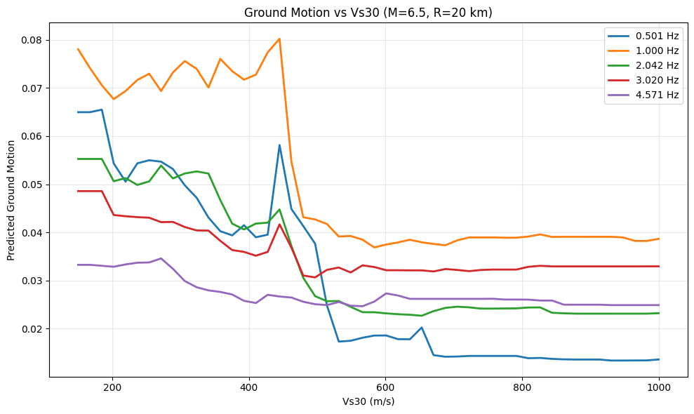

# Machine-Learning Ground-Motion Model (NGA-West2)

A data-driven ground-motion model that predicts **Fourier amplitude spectra (FAS)** at five frequencies from earthquake source, path and site parameters. It is trained on California records from the NGA-West2 database.

## Model

- **Inputs (10 features):** magnitude *M*, rupture distance *R*rup, *V*S30, event and station UTM coordinates, plus log10(*R*rup + 1), log10(*V*S30) and *M*².
- **Targets:** FAS at 0.501, 1.000, 2.042, 3.020 and 4.571 Hz.
- **Algorithm:** one `RandomForestRegressor` per frequency (100 trees, max depth 15), standardised inputs, 80/20 random train–test split.

## Results (hold-out set)

| Frequency (Hz) | R² | RMSE |
|---:|---:|---:|
| 0.501 | 0.649 | 0.0095 |
| 1.000 | 0.696 | 0.0101 |
| 2.042 | 0.710 | 0.0104 |
| 3.020 | 0.751 | 0.0080 |
| 4.571 | 0.660 | 0.0080 |
| **Mean** | **0.693** | |

<p align="center"></p>

The trained model was also probed with scenario sweeps to check that it scales sensibly with magnitude, distance and site stiffness:

| Magnitude (R = 20 km, VS30 = 500 m/s) | Distance (M 6.5, VS30 = 500 m/s) | VS30 (M 6.5, R = 20 km) |
|---|---|---|
|  |  |  |

## Usage

```bash
# Notebook (Colab): open ml_ground_motion_model.ipynb and set the data path
# Script:
python gmm_random_forest.py --data path/to/NGA2West_FAS_CA.csv --out output/
```

The script writes `performance.csv` and the five figures to `--out`.

## Data

`NGA2West_FAS_CA.csv` (NGA-West2 Fourier amplitude spectra for California) is not included. See the [PEER NGA-West2 project](https://peer.berkeley.edu/research/nga-west-2).
