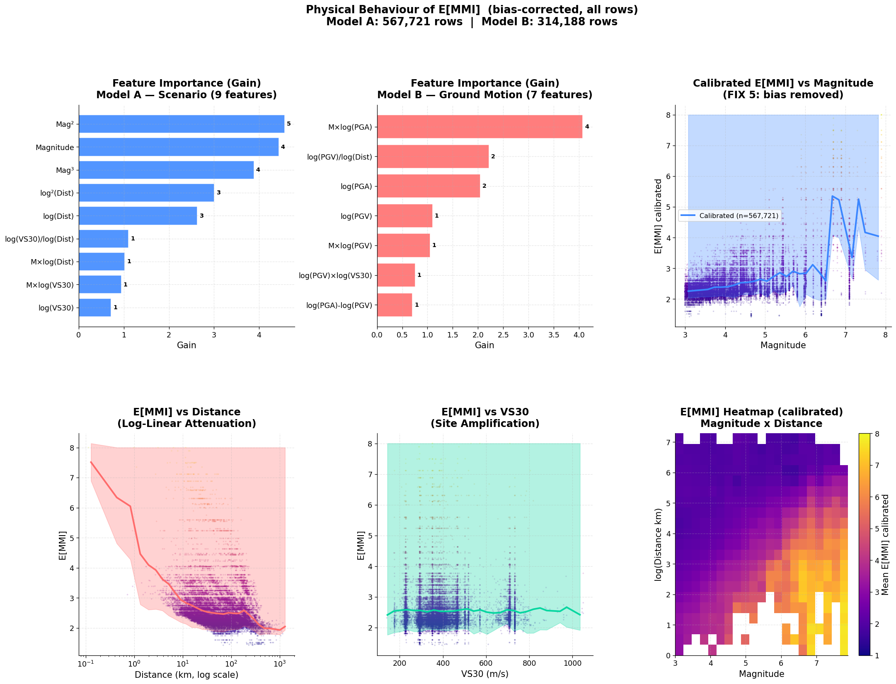

# XGBoost Earthquake Intensity (MMI) Classifier

Predicts Modified Mercalli Intensity (MMI) as a multi-class problem with gradient-boosted trees, and turns the class probabilities into a continuous expected intensity:

$$E[\text{MMI}] = \sum_i \text{MMI}_i \cdot P(\text{MMI}_i \mid \mathbf{x})$$

Two model families are compared:

- **Model A, scenario:** uses only earthquake scenario parameters (magnitude, rupture distance, VS30, plus interaction terms). It can be used *before* shaking is recorded, for example in scenario hazard maps.
- **Model B, ground motion:** uses recorded PGA and PGV, plus interactions with magnitude, distance and site.

## Notebooks

| Notebook | What it does |
|----------|--------------|
| `01_baseline_subsample.ipynb` | Baseline models on an 80k-row stratified subsample |
| `02_full_data.ipynb` | Baseline on all 314,188 rows with valid PGA/PGV |
| `03_full_data_mmi_0_to_10.ipynb` | Full MMI 0–10 class range; separate row sets for A (567k) and B (381k) |
| `04_improved_model.ipynb` | Improved model: richer features, tuned XGBoost, ordinal-aware class weights, isotonic bias correction, A + B ensemble |
| `05_verification_baseline.ipynb` | Verification tests for the baseline model |
| `06_verification_improved.ipynb` | Verification tests and feature ablation for the improved model |

Each notebook runs on its own. Run them in order to follow how the model developed.

## Improved model

| Setting | Value |
|---------|-------|
| Classes | MMI 1–8 (MMI 0, 9 and 10, together under 0.1 % of rows, are clipped) |
| Model A features (9) | M, M², M³, log *R*, log *R*², log VS30, M·log *R*, M·log VS30, log VS30 / log *R* |
| Model B features (7) | log PGA, log PGV, log PGA − log PGV, M·log PGA, M·log PGV, log PGV·log VS30, log PGV / log *R* |
| XGBoost | 600 trees, depth 8, learning rate 0.05, subsample 0.75, α = 0.5, λ = 2.0, early stopping |
| Split | 80/20, stratified by class |

### Results (test set)

| Metric | Baseline | Model A | Model B |
|---|---:|---:|---:|
| Accuracy | 0.432 | 0.530 | 0.449 |
| Balanced accuracy | 0.383 | 0.448 | 0.458 |
| ROC-AUC (macro, one-vs-rest) | 0.855 | 0.856 | 0.865 |
| Within ±1 MMI | 89.1 % | 91.5 % | 92.9 % |
| E[MMI] RMSE | 0.817 | 0.755 | 0.774 |

## Verification

Notebooks 05 and 06 check more than accuracy. They test whether the model behaves physically:

1. **Calibration:** reliability curves and Brier scores for each MMI class.
2. **Physical plausibility:** E[MMI] should increase with magnitude, PGA and PGV, and decrease with distance.
3. **Residuals:** bias of E[MMI] against magnitude, distance, VS30 and PGA.
4. **Monotonicity stress tests:** synthetic sweeps of one variable at a time.
5. **Benchmark:** comparison with an empirical PGA–MMI relation.
6. **Ablation:** contribution of the new interaction features.

## Data

The input file `intensityfiles_alldata_March112026.csv` is not included. Columns used: `magnitude`, `RRUP_Combined`, `VS30 (Thompson (2020) geology based Proxies)`, `PGA (g)`, `PGV`, `intensity`.
