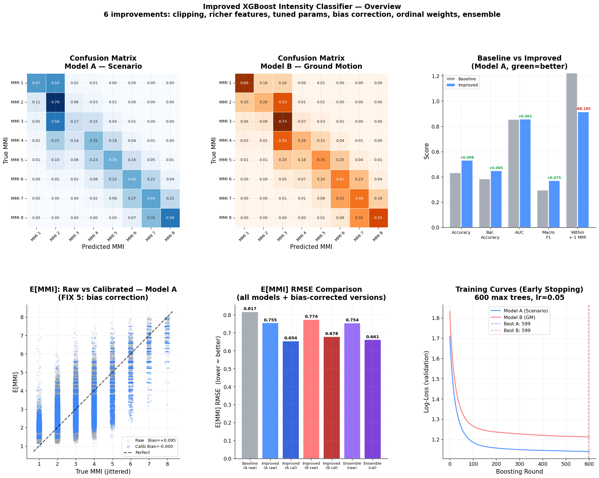

# Earthquake Engineering Research — Site Response & Machine-Learning Ground Motion

**Pukar Singh Basnet** · Lecturer, Department of Civil Engineering, Kathmandu Engineering College (Tribhuvan University), Nepal

This repository collects the code for three research projects in geotechnical earthquake engineering and engineering seismology:

| # | Project | Methods | Data |
|---|---------|---------|------|
| 1 | [1-D site response of Kathmandu Valley boreholes](01-kathmandu-site-response/) | SPT-N → Vs correlations (Ohta & Goto, Imai & Tonouchi), linear amplification functions | 19 boreholes, 38 Vs profiles (included) |
| 2 | [Machine-learning ground-motion model](02-ml-ground-motion-model/) | Random-forest regression of Fourier amplitude spectra | NGA-West2 (California) |
| 3 | [XGBoost earthquake intensity (MMI) classifier](03-xgboost-mmi-classifier/) | Gradient-boosted multi-class classification, expected-MMI, calibration, physical-plausibility tests | ~696k intensity observations |

## Highlights

- **Site response:** Vs profiles and amplification functions (rock-outcrop, incident and borehole) for 19 boreholes in Kathmandu Valley, comparing two SPT-N–Vs correlations.
- **Ground-motion model:** average hold-out R² ≈ 0.69 across five frequencies (0.5–4.6 Hz), with magnitude, distance and Vs30 scaling curves.
- **MMI classifier:** the improved scenario model (magnitude, distance, Vs30) predicts MMI within ±1 unit for 91.5 % of test records (ROC-AUC 0.86). The ground-motion model (PGA, PGV) reaches 92.9 %.

<p align="center">
  
</p>

## Repository layout

```
.
├── 01-kathmandu-site-response/
│   ├── site_response_kathmandu.ipynb   # original analysis, all boreholes
│   ├── run_site_response.py            # batch script over data/vs_profiles.csv
│   ├── data/vs_profiles.csv            # all Vs profiles in one table
│   └── figures/                        # Vs profile + amplification plot per borehole
├── 02-ml-ground-motion-model/
│   ├── ml_ground_motion_model.ipynb
│   ├── gmm_random_forest.py            # command-line version, saves figures
│   └── figures/
├── 03-xgboost-mmi-classifier/
│   ├── notebooks/01…06_*.ipynb         # baseline → improved model → verification
│   └── figures/
├── requirements.txt
└── LICENSE
```

## Getting started

```bash
git clone https://github.com/<your-username>/earthquake-engineering-research.git
cd earthquake-engineering-research
pip install -r requirements.txt
```

The notebooks were developed in **Google Colab** and read data from Google Drive (`/content/drive/MyDrive/Colab Notebooks/data/`). To run them elsewhere, change the data path in each notebook's loading cell. They are saved with their outputs, so the figures and results can be viewed on GitHub without running anything.

## Data availability

- **Project 1:** the Vs profiles are included in `01-kathmandu-site-response/data/vs_profiles.csv`.
- **Project 2:** NGA-West2 Fourier amplitude spectra (`NGA2West_FAS_CA.csv`) are not redistributed here. See the [PEER NGA-West2 database](https://peer.berkeley.edu/research/nga-west-2).
- **Project 3:** the intensity dataset (`intensityfiles_alldata_March112026.csv`) is not included.

## License

Code is released under the [MIT License](LICENSE).

## Contact

Pukar Singh Basnet — Kathmandu Engineering College, Kathmandu, Nepal
